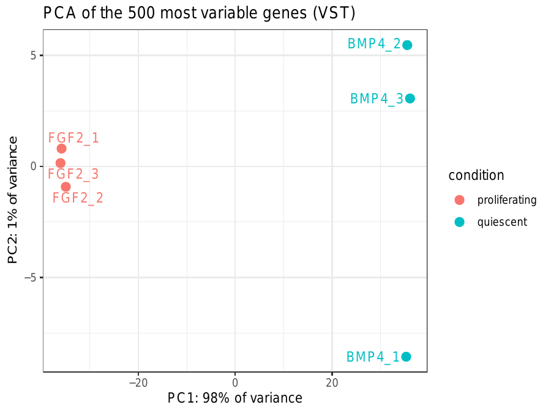
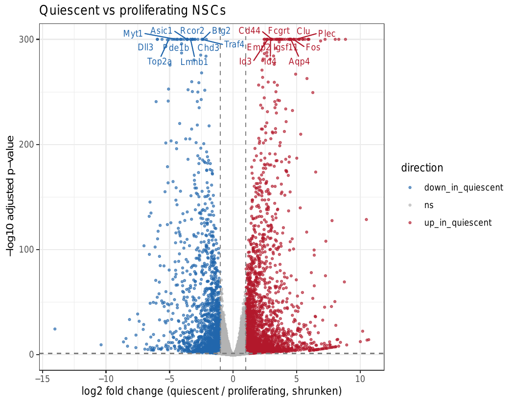
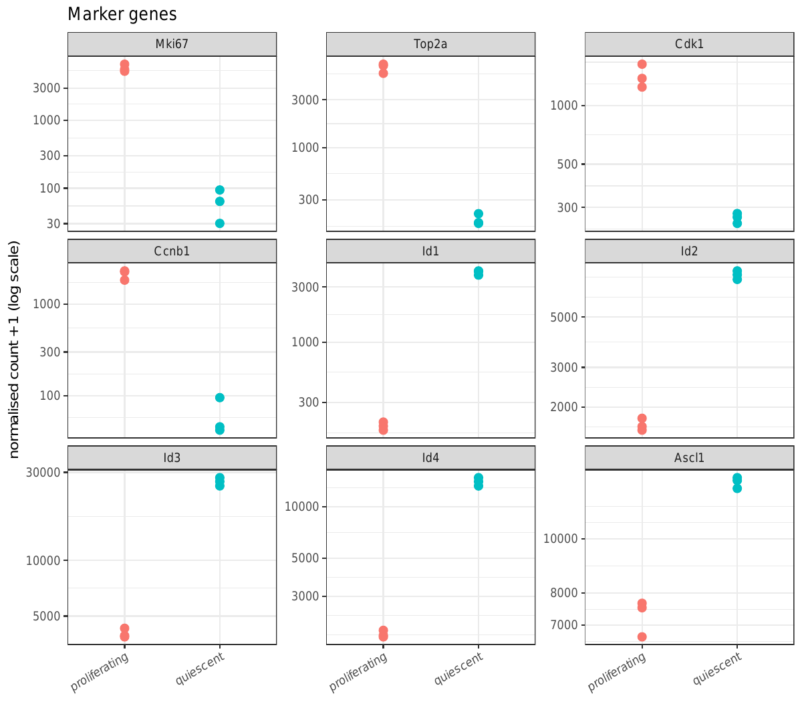
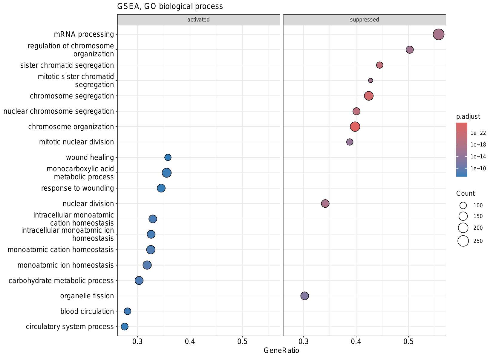

# Bulk RNA-seq: quiescent vs proliferating adult hippocampal neural stem cells

An end-to-end bulk RNA-seq analysis, from raw reads to biological interpretation, of a public dataset:
**GSE116997** (Blomfield *et al.*, 2019, *eLife* 8:e48561).

Adult hippocampal neural stem cells (NSCs) were grown either in **FGF2** (proliferating) or in **FGF2 + BMP4**, which drives them into a reversible, **quiescent** state. This repository reanalyses the wild-type comparison (3 replicates per condition, paired-end 2 × 76 bp, Illumina) with my own pipeline.

**Question:** which genes and biological processes distinguish quiescent from proliferating NSCs?

Author: Romi Marina George

---

## Pipeline

```
SRA (6 samples)  ──prefetch / fasterq-dump──▶  FASTQ
FASTQ            ──FastQC + MultiQC────────▶  quality control (no trimming needed)
FASTQ            ──Salmon (decoy-aware)────▶  transcript quantification
transcripts      ──tximport────────────────▶  gene-level counts
gene counts      ──DESeq2──────────────────▶  QC (PCA), differential expression
DE results       ──clusterProfiler─────────▶  GO enrichment (ORA + GSEA)
```

| Step | Script | Tool(s) |
|---|---|---|
| 1. Download reads | `scripts/01_download.sh` | SRA Toolkit, pigz |
| 2. Read quality control | `scripts/02_qc.sh` | FastQC, MultiQC |
| 3. Build reference index | `scripts/03_salmon_index.sh` | Salmon (GENCODE vM39, GRCm39, genome as decoy, k = 31) |
| 4. Quantify transcripts | `scripts/04_salmon_quant.sh` | Salmon (`-l A`, `--seqBias`, `--gcBias`) |
| 5. Mapping summary | `scripts/05_salmon_summary.sh`, `scripts/plot_salmon_qc.R` | bash, R |
| 6. Transcript-to-gene table | `scripts/06_tx2gene.sh` | awk (GENCODE primary-assembly GTF) |
| 7. Gene-level import | `scripts/07_import_tximport.R` | tximport, DESeq2 |
| 8. Exploratory analysis | `scripts/08_exploratory.R` | DESeq2 (VST), PCA, sample distances |
| 9. Differential expression | `scripts/09_differential_expression.R` | DESeq2 (Wald test), apeglm |
| 10. Functional enrichment | `scripts/10_enrichment.R` | clusterProfiler, org.Mm.eg.db, enrichplot |

The sample sheet is `metadata/samples_expB.tsv`. Software environments are in `environment.yml` (command-line tools) and `environment_r.yml` (R / Bioconductor); exact package versions are in `results/deseq2/sessionInfo.txt` and `results/enrichment/sessionInfo.txt`.

## Key decisions

- **Salmon with a decoy-aware index.** The whole genome was included as a decoy, so reads from unannotated or intronic regions are not forced onto similar transcripts.
- **No adapter trimming.** MultiQC showed adapter content below 0.2% and high base quality across all 76 cycles.
- **Library type detected automatically:** all six samples are `ISR` (inward, stranded, read 1 from the reverse strand), consistent with a dUTP / TruSeq Stranded protocol.
- **Primary-assembly annotation for tx2gene.** The chromosome-only GTF missed 79 transcripts on unplaced scaffolds; the primary-assembly GTF covers every transcript Salmon quantified.
- **Gene filter:** at least 10 reads in at least 3 samples (the size of one group), leaving 17,514 of 77,270 genes.
- **Significance:** Benjamini–Hochberg adjusted p < 0.05 **and** |apeglm-shrunken log2 fold change| ≥ 1 (at least 2-fold).

## Results

### Quality control
- Salmon mapping rate: **92–94%** in all samples.
- PCA of the 500 most variable genes: **PC1 explains 98% of the variance** and separates the two conditions perfectly; replicates cluster tightly.



### Differential expression (quiescent vs proliferating)

| | Genes |
|---|---|
| Expressed and tested | 17,514 |
| Adjusted p < 0.05 | 10,935 |
| Adjusted p < 0.05 and ≥ 2-fold | **4,097** (2,483 up, 1,614 down in quiescence) |



**Sanity check with known genes:** proliferation markers (*Mki67*, *Top2a*, *Cdk1*, *Ccnb1*) are strongly down in quiescent NSCs, and BMP target genes of the *Id* family are up, as expected for BMP4-induced quiescence. *Ascl1* mRNA is modestly higher (1.7-fold, adjusted p ≈ 10⁻²⁷). The original study reports Ascl1 regulation mainly at the protein level, via Id4; a modest mRNA change is compatible with that.



### Functional enrichment (GO Biological Process)

- **Down in quiescence:** almost exclusively mitosis (nuclear division, chromosome segregation, spindle checkpoint), confirming cell-cycle exit.
- **Up in quiescence:** GPCR signalling, ion transport and membrane potential, cell migration and adhesion, and interferon response. These terms resemble published signatures of quiescent NSCs *in vivo*. (GO names such as "heart" or "muscle contraction" reflect shared ion-channel and signalling genes, not a change of cell identity.)
- **GSEA** (all genes ranked by the DESeq2 Wald statistic) agrees, and also shows **lower mRNA processing and chromosome organization** together with **higher fatty-acid (monocarboxylic acid) metabolism** in quiescent NSCs.



## Repository layout

```
scripts/         all analysis code, numbered in the order it runs
metadata/        sample sheet
results/qc/      FastQC and MultiQC reports
results/salmon/  mapping summary table and plot (per-sample outputs not tracked)
results/deseq2/  gene tables, DE results, figures
results/enrichment/  GO enrichment tables and figures
```

Raw reads (`data/`), the reference (`ref/`) and per-sample Salmon outputs are not included because of their size; the scripts regenerate them.

## How to reproduce

```bash
mamba env create -f environment.yml      # command-line tools
mamba env create -f environment_r.yml    # R / Bioconductor
conda activate rnaseq
bash scripts/01_download.sh
bash scripts/02_qc.sh
bash scripts/03_salmon_index.sh
bash scripts/04_salmon_quant.sh
bash scripts/05_salmon_summary.sh
bash scripts/06_tx2gene.sh
conda activate rnaseq-r
Rscript scripts/07_import_tximport.R
Rscript scripts/08_exploratory.R
Rscript scripts/09_differential_expression.R
Rscript scripts/10_enrichment.R
```

Run everything from the project folder. Steps 3–4 need about 16 GB RAM and a few hours on a laptop.

## Reference

Blomfield IM, Rocamonde B, Masdeu MdM, Mulugeta E, Vaga S, van den Berg DLC, Huillard E, Guillemot F, Urbán N. *Id4 promotes the elimination of the pro-activation factor Ascl1 to maintain quiescence of adult hippocampal stem cells.* eLife 2019;8:e48561. Data: GEO GSE116997.
